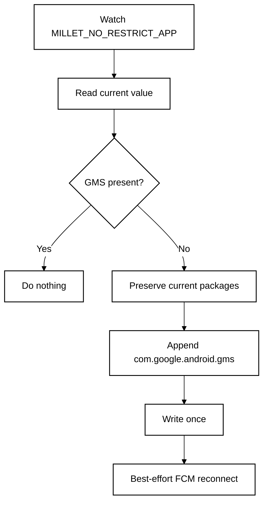

<p align="center">
  <a href="README.md"><strong>English</strong></a> · <a href="README.zh-CN.md">简体中文</a>
</p>

<p align="center">
  
</p>

# FCMGuard 2.0 for HyperOS

**A no-root watchdog for HyperOS with verified GMS whitelist recovery, selected-app diagnostics and an optional Shizuku backend.**

**Designed for:** China-market Xiaomi / Redmi / POCO phones with Google Play services already installed and working.

<p align="center">
  <a href="https://github.com/ReedGAOOO/FCMGuard-HyperOS/releases/latest/download/FCMGuard-HyperOS.apk"><strong>Original upstream APK (1.5.9)</strong></a>
  ·
  <a href="https://github.com/ReedGAOOO/FCMGuard-HyperOS/releases/latest">Original upstream releases</a>
</p>

## FCMGuard 2.0 fork

This fork adds selected-app protection and safe automatic recovery while preserving the upstream
GMS whitelist guard. **Standard Protection requires neither root nor Shizuku.** Optional Shizuku
Enhanced Protection repairs only verified background AppOps for apps you explicitly select at MAXIMUM.

- Native Home health dashboard, Protected Apps, App Detail, Diagnostics, Repair History and Settings.
- Backend-independent RecoveryEngine, verify-after-repair, persisted cooldown and failure stop.
- Exact ContentObserver + 400 ms debounce, network/package callbacks, existing non-waking 30-minute fallback.
- Local selection (up to 64 apps), bounded history (100 records), no accounts/content/token/traffic collection.
- Honest UNKNOWN/UNSUPPORTED states: a heartbeat request is not proof of an authenticated FCM connection.
- Existing advanced configuration, locale/theme, autostart assistant and boot behavior retained.
- compileSdk 35 / **targetSdk 22 preserved** for Xiaomi private WRITE_SETTINGS compatibility.

### Setup

1. Build/install this fork (upstream release links above are the original 1.5.9 app).
2. Settings → Automatic protection / appearance / language → grant Modify system settings and enable protection.
3. Enable Autostart and No restrictions for FCMGuard in HyperOS. Persistent notification is recommended.
4. Add Protected Apps and choose NORMAL, STRONG or MAXIMUM. Run Full Check, then inspect app details.
5. Optional: start Shizuku, opt into enhanced protection and grant permission. MAXIMUM falls back to STRONG
   whenever Shizuku is unavailable. Vendor autostart/battery policies remain read-only/manual.

Automatic repair does not guarantee notification delivery. Test real push latency on your device;
app-specific processing, vendor restrictions, channels and the live MCS connection can remain unreadable.

### Developer documentation

- [Architecture and upstream audit](docs/ARCHITECTURE.md)
- [Recovery decisions, limits and tests](docs/RECOVERY_ENGINE.md)
- [Optional Shizuku scope and setup](docs/SHIZUKU.md)
- [Protected Apps and levels](docs/PROTECTED_APPS.md)

Build: JDK 17, Android SDK 35, Gradle 8.7.

```sh
python3 tools/check_layout_profiles.py
gradle :app:testDebugUnitTest :app:lintDebug :app:assembleDebug
```

CI creates the configured debug signing key. For a local build, use the same `ci-signing` key path/alias
as the workflow, or supply your own signing configuration. A fork key differs from upstream; installing
over an upstream-signed app may require uninstalling first. New native feature screens currently use
English labels; the retained advanced settings keep all upstream translations.

## Original upstream documentation (1.5.9)

The following describes the original Standard-only app and its upstream releases.

## Highlights

- **No root or Shizuku** — uses the user-grantable **Modify system settings** permission instead of root, persistent ADB, Accessibility, VPN, overlay, or device-admin privileges.
- **Finance-app friendly** — keeps the implementation deliberately low-privilege for better compatibility with security-sensitive apps.
- **Low background power** — exact event-driven monitoring is the main path; the 30-minute fallback is in-process and does not deliberately wake a sleeping phone.
- **Reconnects only when needed** — FCM/MCS reconnect broadcasts are sent only after a real whitelist repair or a manual request.
- **Optional persistent notification** — foreground mode uses a visible-but-silent notification channel for stronger process survival; quiet background mode remains available.
- **FCM app assistant** — scans likely Firebase/GCM clients and, when HyperOS exposes the vendor AppOps state, shows read-only Autostart status with automatic re-check after returning from system settings.
- **Native dark mode** — System / Light / Dark, with **System** as the default.
- **10-language UI** — English, Simplified Chinese, Traditional Chinese, French, Japanese, Korean, Spanish, Portuguese, German, and Russian through Android's native per-app language mechanism.
- **Compact-phone ready** — responsive layout checks cover 320–480dp widths, including a Xiaomi 17-class 393dp profile.

## Quick setup

1. Install the latest APK from **GitHub Releases**.
2. Open FCM Guard and grant **Modify system settings**.
3. Tap **Repair now** once.
4. Enable **Automatic protection**.
5. In HyperOS, enable **Autostart** for FCM Guard and set battery policy to **No restrictions**.
6. Keep **Persistent notification** enabled for maximum survival reliability. If Android/HyperOS blocks notifications for FCM Guard, the app opens the system notification settings so the foreground notification can be enabled.
7. Optional: scan **FCM apps**. If HyperOS exposes readable Autostart state, the list marks apps as Enabled / Partial / Disabled / Unknown and refreshes after you return from **Configure all in HyperOS**. If the ROM blocks the query, FCM Guard shows a clear Unknown/unavailable fallback instead of guessing.
8. Optional: tap **Open FCM diagnostics** to open Google Play services diagnostics and inspect the `mtalk.google.com:5228` connection.
9. If one app still receives notifications late while other FCM apps are normal, configure that app separately. For apps such as **WhatsApp**, set **Battery saver / Battery optimization → No restrictions** in HyperOS; enabling **Autostart** is also recommended when available.

> FCM Guard is mainly for China-ROM HyperOS 3 devices where Google services work normally but PowerKeeper / Greezer can still interrupt the background FCM connection.

---

# Technical overview

## Core mechanism

Affected HyperOS builds can rebuild the private setting:

```text
Settings.System.MILLET_NO_RESTRICT_APP
```

If `com.google.android.gms` is removed, Google Play services can be treated like a normal background process and its long-lived FCM/MCS connection may be interrupted.

FCM Guard reads the current comma-separated value, preserves all existing packages, and appends `com.google.android.gms` only when it is missing.



## Why `targetSdk 22`?

FCM Guard intentionally uses `compileSdk 35` with `targetSdk 22`. The modern compile SDK keeps current tooling, while the legacy target preserves the compatibility path needed to write Xiaomi's vendor-private `Settings.System` key with the user-grantable **Modify system settings** permission and without root/Shizuku.

## Low-power design

- Exact `ContentObserver` only for `MILLET_NO_RESTRICT_APP`.
- ~400 ms debounce after an observed change.
- 30-minute in-process fallback instead of rapid polling.
- No `AlarmManager`, repeating exact alarm, or WakeLock for the fallback.
- No write when GMS is already present.
- No reconnect broadcast unless a repair actually happened or the user requests one.

## Persistent notification

Persistent mode runs `GuardService` as a foreground service. The current implementation uses a dedicated `IMPORTANCE_LOW`, silent notification channel so the notification remains visible without sound or vibration. Because FCM Guard deliberately targets SDK 22, Android 13+ controls the notification-permission prompt timing; if notifications are already blocked, FCM Guard links directly to the app's system notification settings.

## FCM diagnostics

**Open FCM diagnostics** now launches the current Google Play services activity first:

```text
com.google.android.gms/com.google.android.gms.gcm.GcmDiagnostics
```

Older `GTalkServiceDiagnostics` is retained as a compatibility fallback, with a final best-effort lookup for a diagnostics activity inside Google Play services.

## FCM app assistant

The scanner looks for standard manifest signals such as:

```text
com.google.firebase.MESSAGING_EVENT
com.google.android.c2dm.intent.RECEIVE
```

A match means the app is a likely FCM/GCM client, not proof that every notification from that app uses FCM.

For detected apps, FCM Guard performs a **read-only, best-effort** check of Xiaomi's vendor Autostart AppOps (`10008` and `10053`). When both are readable, the UI reports:

- **Enabled** — both Autostart AppOps are allowed.
- **Partial** — one is allowed and the other is explicitly ignored.
- **Disabled** — both are explicitly ignored.
- **Unknown** — HyperOS blocked the query, returned a vendor/default state that cannot be interpreted safely, or otherwise did not expose a reliable result.

FCM Guard never treats **Unknown** as **Disabled**. If every detected app is Unknown, the per-app list is hidden and the assistant falls back to the detected count plus the single **Configure all in HyperOS** action. After returning from HyperOS settings, an expanded result is checked again automatically.

No Autostart state is modified programmatically, and no Shizuku/root/ADB privilege is introduced.

## Per-app delivery caveat

FCM Guard protects the Google Play services / FCM transport layer, but it does **not** override HyperOS battery rules for every receiving app. Some apps — including messaging apps such as **WhatsApp** — may use FCM as a wake-up/tickle path and still need their own process to run, open a background network connection, synchronize data, and generate the local notification.

Therefore, if FCM diagnostics are healthy and other apps receive pushes normally but one app is still delayed, configure that app separately. For WhatsApp, the recommended HyperOS setting is:

**WhatsApp → Battery saver / Battery optimization → No restrictions**

Also enable **Autostart** for the affected app when the ROM exposes that option. This should be applied only to apps that actually show delayed delivery rather than globally disabling battery optimization for every app.

## Appearance, languages, and responsive layout

- System / Light / Dark appearance modes.
- 10 native app languages: English, Simplified Chinese, Traditional Chinese, French, Japanese, Korean, Spanish, Portuguese, German, and Russian.
- Compact and large-width resource profiles.
- CI geometry checks for 320, 360, 393, 411, 430, and 480dp widths.

## Permissions and privacy

FCM Guard uses `WRITE_SETTINGS`, `RECEIVE_BOOT_COMPLETED`, foreground-service/notification support, and narrow package visibility for FCM/GCM handlers, Google Play services, and Xiaomi Security Center.

It does **not** require root, Shizuku, persistent ADB, Accessibility, VPN, overlay, device-admin, account access, or traffic inspection.

## Limitations

This project depends on Xiaomi's current HyperOS implementation. Xiaomi can change PowerKeeper / Greezer behavior, the private setting, app-management pages, or vendor AppOps behavior in future releases. FCM reconnect, FCM-client detection, and Autostart-status reading are all best-effort because Android does not expose public APIs that guarantee these vendor-specific operations.

FCM Guard protects the shared GMS/FCM connection; it cannot guarantee that HyperOS will allow every individual app enough background execution or network time to process a delivered FCM wake-up. Per-app battery settings may still be required for apps such as WhatsApp.

## References & Acknowledgements

The PowerKeeper / Greezer investigation and the `MILLET_NO_RESTRICT_APP` repair strategy were originally documented by **HyperOS FCM Fix**:

- HyperOS FCM Fix by `dingwen07`: https://github.com/dingwen07/hyperos-fcm-fix
- Technical investigation: https://github.com/dingwen07/hyperos-fcm-fix/blob/main/docs/xiaomi-hyperos-gms-fcm-greezer-investigation.md

FCM Guard is an independent implementation focused on no Shizuku/root dependency, minimal privileges, event-driven monitoring, and low idle background activity. No source code from HyperOS FCM Fix is copied into this repository.

## Build

GitHub Actions checks responsive layout profiles and builds a signed debug APK. Pushes to `main` publish/update the versioned GitHub Release; feature branches can be validated before release.

For normal phone installation, use:

**https://github.com/ReedGAOOO/FCMGuard-HyperOS/releases/latest/download/FCMGuard-HyperOS.apk**

## License

MIT License — see [LICENSE](LICENSE).
